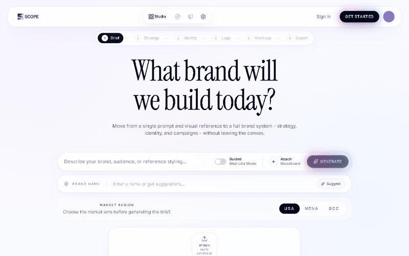
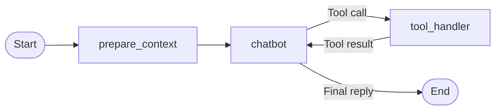

# SCOPE Studio

Turn a founder’s brief into a brand system. SCOPE keeps six strategy pillars on an editable canvas, where a founder can revise the brand promise with a bilingual copilot before choosing colors, type, and a logo direction.

[](docs/media/studio-tour.mp4)

[Watch the 12-second video](docs/media/studio-tour.mp4) · [Brief intake](docs/media/brief.png) · [Strategy canvas](docs/media/strategy.png) · [Pillar editor](docs/media/pillars.png) · [Identity studio](docs/media/identity.png)

The walkthrough uses the running frontend with a fictional community bike-repair brand supplied as demo data. The identity screen shows the studio’s built-in palette options.

## From brief to brand

1. **Write a brief.** Describe the business, add visual references, and select a market. A DSPy pipeline refines the input, generates a marketing brief, and evaluates its quality before the founder approves it.
2. **Shape the strategy.** Explore mission, vision, persona, values, voice, and promise on an orbital canvas. Edit a pillar inline or discuss a revision with the copilot in English or Arabic.
3. **Choose a visual direction.** Select a palette, type pairing, and concept. Carry those choices forward to the logo, mockup, and export screens.

## Inside the LangGraph copilot

The copilot prepares the session context before calling the model. A tool call can propose a brand-node revision or a color palette. The tool result returns to the model so it can explain the proposal in the same conversation.



[Graph implementation](backend/app/agents/brand_agent.py) · [DSPy brief pipeline](backend/app/agents/prompt_pipeline.py) · [Interactive canvas](src/routes/canvas.tsx)

## Run locally

You need Docker Compose, Node.js with npm, and an OpenRouter key for model-backed features. The frontend can run on its own to explore the intake and identity screens.

1. Copy `.env.example` to `.env` and `backend/.env.example` to `backend/.env`.
2. Set `POSTGRES_PASSWORD` in the root file. In the backend file, set `JWT_SECRET` and `OPENROUTER_API_KEY`. Generate separate URL-safe values for the database password and JWT secret. Run `python -c "import secrets; print(secrets.token_urlsafe(48))"` once for each.
3. From the repository root, start the API and database, then the frontend.

```sh
docker compose up -d --build
npm ci
npm run dev
```

Open the address printed by Vite. The frontend connects to the local FastAPI service at `http://localhost:8000`. Compose stores PostgreSQL data in a named volume. For an existing volume, configure its existing database password or change that role’s password before switching credentials.

## Explore the implementation

| Layer | Implementation |
| --- | --- |
| React and TanStack Start | [Studio routes](src/routes), [canvas and copilot components](src/components/scope) |
| FastAPI and SQLAlchemy | [HTTP routes](backend/app/api), [PostgreSQL models](backend/app/db/models.py) |
| Model orchestration | [LangGraph, DSPy, and identity generation](backend/app/agents) |

[Architecture notes](docs/ARCHITECTURE.md) · [Local development commands](COMMANDS.md)
